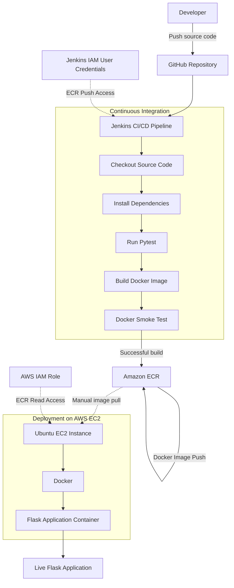

# AWS DevOps CI/CD Pipeline for Flask Application

## 1. Project Overview

This project demonstrates an end-to-end DevOps CI/CD workflow for building, testing, containerizing, and deploying a Python Flask application using Jenkins, Docker, and AWS services.

Jenkins automates application testing, Docker image creation, smoke testing, and publishing images to Amazon Elastic Container Registry (ECR). The published image is then manually pulled and deployed on an Amazon EC2 Ubuntu instance.

## 2. Architecture Diagram



**Workflow:** GitHub → Jenkins → Pytest → Docker Build → Smoke Test → AWS ECR → EC2 → Flask Application.

Note: The ECR-to-EC2 deployment step is currently manual. Automated EC2 deployment is planned as a future enhancement.

## 3. Technologies Used

| Technology | Purpose |
|---|---|
| Linux (Ubuntu/WSL) | Development environment |
| Git | Version control |
| GitHub | Source code management |
| Python | Application development |
| Flask | Web framework |
| Pytest | Unit testing |
| Docker | Containerization |
| Jenkins | CI/CD automation |
| AWS ECR | Docker image registry |
| AWS EC2 | Application hosting |
| AWS IAM | Access management |

## 4. Project Structure

```text
devops-flask-project/
│
├── app/
│   └── app.py
│
├── tests/
│
├── Dockerfile
├── Jenkinsfile
├── requirements.txt
└── README.md
```

## 5. Application Features

- Python Flask web application.
- Health check endpoint (`/health`).
- Automated unit testing using Pytest.
- Docker image creation.
- Jenkins CI/CD pipeline.
- Docker container smoke testing.
- Docker image publishing to AWS ECR.
- Container deployment on AWS EC2.

## 6. CI/CD Pipeline Stages

### Stage 1: Checkout
Retrieves application source code from GitHub.

### Stage 2: Install Dependencies
- Creates a Python virtual environment.
- Installs application dependencies.
- Installs Pytest.

### Stage 3: Unit Testing
Executes automated tests using Pytest. The pipeline stops if tests fail.

### Stage 4: Docker Build
Builds the Docker image with a version-specific tag and a `latest` tag.

### Stage 5: Smoke Testing
- Starts a temporary Docker container.
- Tests the Flask health endpoint.
- Removes the temporary container after testing.

### Stage 6: Push to AWS ECR
- Authenticates with AWS ECR.
- Tags the Docker image.
- Pushes version-specific and `latest` images to ECR.

## 7. AWS Configuration

| Configuration | Value |
|---|---|
| AWS Region | ap-south-1 (Mumbai) |
| ECR Repository | devops-flask-app |
| EC2 Operating System | Ubuntu Server 24.04 LTS |
| EC2 Instance Type | t3.micro |
| EC2 IAM Role | EC2-ECR-Pull-Role |
| Security Group | devops-flask-sg |
| Application Port | 5000 |

## 8. EC2 Deployment

### Install Docker and AWS CLI

```bash
sudo apt update
sudo apt install -y docker.io unzip curl
sudo systemctl enable --now docker
```

AWS CLI was installed separately using the official AWS CLI v2 installer.

### Authenticate with AWS ECR

```bash
aws ecr get-login-password --region ap-south-1 | sudo docker login --username AWS --password-stdin <AWS_ACCOUNT_ID>.dkr.ecr.ap-south-1.amazonaws.com
```

### Pull Docker Image

```bash
sudo docker pull <AWS_ACCOUNT_ID>.dkr.ecr.ap-south-1.amazonaws.com/devops-flask-app:latest
```

### Run Flask Application

```bash
sudo docker run -d \
  --name flask-app \
  --restart unless-stopped \
  -p 5000:5000 \
  <AWS_ACCOUNT_ID>.dkr.ecr.ap-south-1.amazonaws.com/devops-flask-app:latest
```

### Verify Container

```bash
sudo docker ps
```

### Test Application Health

```bash
curl http://localhost:5000/health
```

Expected response:

```json
{
  "status": "healthy"
}
```

Application URL:

```text
http://EC2_PUBLIC_IP:5000
```

## 9. Security Implementation

- Dedicated IAM user for Jenkins ECR access.
- AWS credentials stored in Jenkins Credentials.
- EC2 IAM instance role for ECR image pulling.
- No static AWS access keys stored on EC2.
- SSH access restricted to My IP.
- Application port access configured through the EC2 security group.

## 10. Key Learning Outcomes

- Jenkins pipeline creation and troubleshooting.
- CI/CD automation.
- Linux administration.
- Python application testing.
- Docker image building and container management.
- AWS ECR integration.
- AWS EC2 deployment.
- IAM users, policies, roles, and permissions.
- Application health checks and deployment troubleshooting.

## 11. Future Enhancements

- Automate EC2 deployment through Jenkins.
- Configure GitHub webhooks.
- Implement Terraform for Infrastructure as Code.
- Deploy using Kubernetes.
- Add Prometheus and Grafana monitoring.
- Configure Nginx as a reverse proxy.
- Implement HTTPS using SSL/TLS.

## 12. Cost Management

- Use eligible free-tier resources or available AWS credits where applicable.
- Stop EC2 instances when not in use.
- Monitor EBS storage and public IPv4 charges.
- Remove unused resources.
- Review AWS Billing regularly.

## 13. Author

**Rajaneesh**

2025 B.Tech Graduate | Aspiring DevOps Engineer

Interested in DevOps, Cloud Computing, Linux, Docker, Jenkins, and AWS.

GitHub: https://github.com/Rajaneesh2410

---

*Built as a hands-on project to demonstrate practical DevOps automation, containerization, and AWS deployment skills.*
